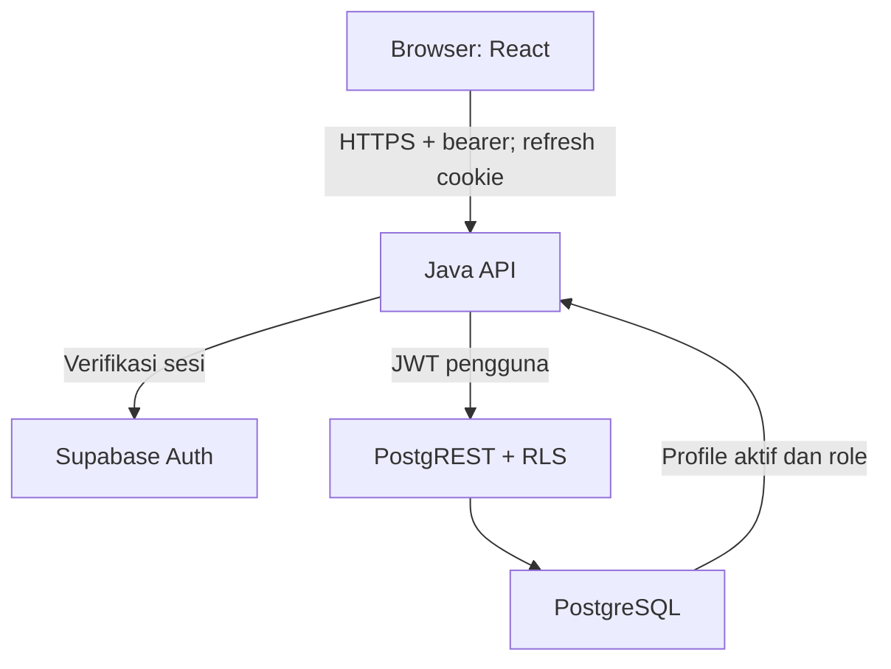

# Architecture — Depor CS HUB

## Sistem yang ada

Dua repository terpisah:

- [Frontend](https://github.com/DeporCS-HUB/Frontend-DeporCS-Hub): React 19, Vite, React Router, CSS, Playwright.
- [Backend](https://github.com/DeporCS-HUB/Backend-DeporCS-Hub): Java 21, Spring Boot 3.5.7, Maven, Spring Security, Bean Validation.

Supabase menyediakan Auth, Postgres dan PostgREST. Vercel adalah target hosting yang dipilih pengguna. Node dipakai untuk tooling/build frontend, bukan runtime bisnis backend.

## Pembagian tanggung jawab

| Bagian | Tanggung jawab |
| --- | --- |
| Halaman React | Interaksi, filter, form, dialog Detail, chart dan state tampilan |
| `src/lib/api.js` | Request, bearer di memori, refresh tunggal, invalidasi cache dan isolasi akun |
| `src/lib/read-cache.js` | Deduplikasi GET; TTL 30 detik; batas 100 entri |
| Controller Java | Route dan validasi DTO; bentuk response |
| `DataService` | Izin resource, mapping PJ, pemanggilan PostgREST/RPC |
| `Security` / adapter Supabase | Origin, autentikasi aktif, mapping role, sanitasi error |
| Postgres RLS/trigger/RPC | Izin baris/kolom, penyimpanan PJ atomik, audit dan agregasi dashboard |

## Alur autentikasi

Login dikirim ke Java dan diteruskan ke Supabase Auth. Java memverifikasi access token serta profile aktif. Browser menerima access token untuk memori; refresh token ditempatkan pada cookie HttpOnly `depor_refresh`.

Request data menggunakan bearer. Ketika mendapat 401, frontend mencoba refresh terkoordinasi dan mengulang request sekali. Refresh gagal menghapus sesi lokal. Mutasi Auth memerlukan Origin yang persis diizinkan. Logout membersihkan cookie dan mencabut refresh session terkait; access token yang sudah disalin dapat bertahan sampai expiry, sehingga profile aktif tetap diperiksa.

## Alur update progres

1. UI menampilkan Update progres hanya untuk BPH/PJ berdasarkan UUID.
2. Java menerima tiga field yang diizinkan dan memeriksa PJ.
3. Request diteruskan memakai JWT pengguna, bukan service role.
4. RLS memeriksa assignment; trigger membatasi kolom Staff.
5. Perubahan status/persentase/catatan yang nyata menambah audit actor. Save identik tidak menambah aktivitas.
6. Write berhasil menginvalidasi cache; write gagal mempertahankan data terkonfirmasi.

Edit lengkap BPH memakai `save_program` agar record dan semua assignment tersimpan dalam satu transaksi. Izin UI membantu UX; backend dan RLS tetap otoritatif.

## Performa dan state

Route dan finance chart dimuat terpisah. Dashboard chart memakai HTML/CSS/SVG native dan tidak memerlukan bundle chart finansial. Cache hanya di memori; error tidak dicache. Logout/perubahan akun/role membersihkan scope cache. Respons request lama dari akun sebelumnya tidak boleh masuk ke state akun baru.

Dashboard mengambil satu endpoint agregat. Hitungan global dan distribusi status terpisah dari programFocus (pratinjau 30). Status/progres assignment Staff berasal langsung dari join lengkap. Daftar memakai filter server sebelum pagination; pencarian didebounce 250 ms, perubahan filter kembali ke halaman 1, dan meta.hasMore dipertahankan dalam cache. Ukuran halaman: program 10, inventaris 12, lainnya 20; lookahead backend memastikan tombol berikutnya akurat tanpa count seluruh list.

## Deployment dan konfigurasi

Frontend dan backend mempunyai project Vercel terpisah. Frontend memakai `VITE_API_URL` berakhiran `/api`; rewrite SPA bukan proxy backend. Backend memakai Origin frontend yang persis, PORT 8080, dan cookie secure untuk HTTPS. SameSite None diperlukan untuk model lintas origin yang dipakai; kebijakan third-party cookie browser tetap harus diuji.

Kredensial backend disimpan di environment terkelola. Spring tidak memuat `.env` secara otomatis. Semua nilai `VITE_*` menjadi publik. Alternatif Render/nginx yang ada di repository bukan instruksi untuk memprovision hosting kedua.

## Batas arsitektur dan pengujian

Belum ada push Realtime, job notifikasi, file upload, optimistic locking untuk edit lengkap, atau admin role UI. Tes mock tidak membuktikan login hosted. SQL dengan simulated JWT menguji grants/RLS, bukan validitas password/session browser. Catat bukti masing-masing tingkat secara terpisah.

## Workspace program dan papan tugas

Route /programs/:id dimuat terpisah dan menyediakan Ringkasan/Tugas/Timeline/Agenda. Deskripsi/catatan panjang tetap clamp tiga baris dan dialog scroll. Program tunggal dibaca dari API; hidden buttons bukan batas izin. BPH mengatur profil program/PJ; BPH/PJ dapat menambah catatan, mengelola agenda dan memperbarui progres. Scope tugas mengikuti izin program dan aturan owner.

Board menggunakan lima collection paginated independen (12 kartu per kolom) dan satu summary terfilter global, dimulai paralel. Tampilan daftar 20 per halaman. Metadata akun/program dibaca paralel, memakai deduplikasi cache yang sama. Total tidak diturunkan dari page kartu. Perubahan filter mereset cursor, termasuk kembali ke filter lama. Pencarian debounce 250 ms. Route chart tidak mendapat dependency baru.

Drag/drop dan select keyboard memakai endpoint status-only dengan updated_at guard opsional; respons 409 tidak dianggap sukses. Cache tetap per akun dan invalidasi setelah commit. Muat ulang hanya menghapus cache dan meminta read terbaru; belum ada push/auto-polling. Pencabutan PJ berlaku pada request API/database berikutnya; data yang telah dibaca tidak dapat ditarik kembali dari layar tanpa refresh.

Migrasi dilakukan sebelum backend dan frontend baru; tidak memakai service role untuk request aplikasi dan tidak menambah layanan berbayar. Fixture hanya database disposable. Hosted RLS simulated-JWT read membuktikan kebijakan baca, bukan login Supabase Auth lewat browser.

## Akun sendiri dan media profil

Settings tetap route lazy, dengan kartu foto/nama/password. Avatar initial hanya meminta signed URL jika profile memiliki avatar_path; dua instance (header/Settings) dideduplikasi cache. Refresh, write berhasil, serta pergantian akun tetap mengikuti invalidasi yang ada. Tidak ada dependency gambar/SDK/chart baru.

Alur foto: validasi file browser → crop/encode JPEG → API decode/dimensi/re-encode → Storage upload versi UUID dengan JWT caller → conditional update profile pointer → cleanup file lama. Compare-and-set pointer mencegah perubahan paralel menimpa foto baru. Ini bukan transaksi atomik lintas Storage/Postgres; response jaringan ambigu/cleanup gagal dapat meninggalkan objek privat yatim. Tidak menimpa atau menghapus foto lama sebelum profile commit.

Alur password: Auth user terverifikasi → email server → password grant memverifikasi password saat ini → check ID sama → update password memakai token session segar → response mengganti access token/refresh cookie. Fresh sign-in menghindari ketergantungan pada toggle current-password project dan nonce sesi lama. Tidak menggunakan service role atau password SQL/RPC. Error validasi tidak menghapus sesi yang masih valid. Respons password tidak boleh mengembalikan snapshot nama/foto yang lebih lama dari perubahan lokal yang sudah terkonfirmasi.

Pengujian HTTP adapter dan browser menggunakan upstream/API mock; SQL memakai stand-in Storage. Hosted config/RLS diperiksa terpisah. Mengganti password atau mengunggah foto akun nyata bukan bagian dari tes tanpa sesi/kredensial yang sesuai; jangan reset password untuk memperoleh bukti tersebut.
